# RequestsSystem

[](https://github.com/tamarmargi/RequestsSystem/actions/workflows/ci.yml)


A system for managing requests from organizations: a server-side searchable, filterable and paged list of
100,000 requests, status updates with optimistic concurrency and audit history, bulk updates with partial
success, and cached statistics — ASP.NET Core 8, EF Core, SQL Server 2022 and Angular 21.

<div dir="rtl">

**תקציר.** מערכת לניהול פניות של ארגונים. המסך מציג 100,000 פניות עם חיפוש, סינון, מיון ודפדוף בצד השרת,
מאפשר לשנות סטטוס של פנייה אחת או של כמה פניות יחד, מזהה התנגשות כששני משתמשים מעדכנים את אותה פנייה
ומאפשר להחליט מה לעשות, ושומר היסטוריית שינויים מלאה. הנתונים המסכמים נשמרים ב-Cache, והאינדקסים נבחרו
לפי מדידה של השאילתות האמיתיות.

</div>

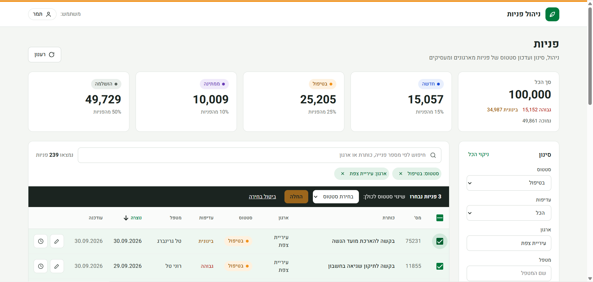

## Contents

- [Quick start (Docker)](#quick-start-docker) · [For reviewers](#for-reviewers) · [Screenshots](#screenshots) ·
  [Design](#design) · [Architecture](#architecture)
- [API](#api) · [Frontend](#frontend) · [Database & Indexes](#database--indexes) · [Concurrency](#concurrency) ·
  [Bulk Update](#bulk-update) · [Cache](#cache) · [Performance](#performance) · [Running tests](#running-tests)
- [Local development](#local-development) · [Test Data](#test-data) · [Technical Decisions](#technical-decisions) ·
  [Known Limitations](#known-limitations) · [AI Usage](#ai-usage)
- Docs: [work plan](docs/work-plan.md) · [API contract](docs/api-contract.md) ·
  [decisions](docs/decisions.md) · [performance report](docs/performance/README.md)

## Quick start (Docker)

Only [Docker](https://www.docker.com/) is needed. From the repository root:

```bash
docker compose up --build
```

- UI: http://localhost:4200
- API (Swagger): http://localhost:5000/swagger

The first start takes a few minutes: the images are built, and the API applies the migrations and seeds
100,000 requests when the database is empty. Later starts keep the data (and your changes) and are much
faster. `docker compose down` stops everything; `docker compose down -v` also deletes the database volume.

<details>
<summary>What runs, and the startup options</summary>

| Service | Image | Port | Notes |
|---|---|---|---|
| `sqlserver` | SQL Server 2022 | 1435 → 1433 | Data in the `sqlserver-data` volume |
| `api` | [backend/Dockerfile](backend/Dockerfile) (.NET 8 SDK build → ASP.NET Core 8 runtime) | 5000 → 8080 | `Database__MigrateOnStartup=true`, `Seed__OnStartupIfEmpty=true`, Swagger on (`Development`), healthcheck on `/api/health` |
| `web` | [frontend/Dockerfile](frontend/Dockerfile) (Node build → nginx) | 4200 → 80 | [nginx.conf](frontend/nginx.conf) serves the app and proxies `/api` to `api:8080` |

> The SQL Server password is taken from `.env` if it exists, otherwise from the default in
> [docker-compose.yml](docker-compose.yml), which is the same as in [.env.example](.env.example). It is a
> **local development password only**.

### Startup options

Both are **off by default** (`appsettings.json`) and switched on only by `docker-compose.yml`:

| Setting | Effect |
|---|---|
| `Database:MigrateOnStartup` | Applies pending EF Core migrations when the API starts, and logs how long it took. |
| `Seed:OnStartupIfEmpty` | Runs the seeder (100,000 requests) only if the `Requests` table is empty, so restarts keep the data; logs whether it ran or was skipped, and how long it took. |

Outside Docker, migrations stay explicit (`dotnet ef database update`), see [decision 35](docs/decisions.md).

</details>

## For reviewers

Where each section of the assessment is implemented, tested and documented.

| # | Requirement | Implementation | Tests | Documentation |
|---|---|---|---|---|
| 1 | Data retrieval: server-side search, filters, sorting, paging, stats | [RequestsController](backend/src/Requests.Api/Controllers/RequestsController.cs), [RequestQueryService](backend/src/Requests.BL/Services/RequestQueryService.cs), [RequestRepository](backend/src/Requests.DAL/Repositories/RequestRepository.cs), [RequestQueryParametersValidator](backend/src/Requests.BL/Validation/RequestQueryParametersValidator.cs) | [RequestsApiTests](backend/tests/Requests.Tests/Integration/RequestsApiTests.cs), [RequestQueryParametersValidatorTests](backend/tests/Requests.Tests/Validation/RequestQueryParametersValidatorTests.cs) | [API](#api), [Avoiding loading all data into memory](#avoiding-loading-all-data-into-memory), [API contract](docs/api-contract.md) |
| 2 | Status update with optimistic concurrency | [RequestCommandService](backend/src/Requests.BL/Services/RequestCommandService.cs), [StatusTransitions](backend/src/Requests.BL/Domain/StatusTransitions.cs), [AutoAssignment](backend/src/Requests.BL/Domain/AutoAssignment.cs), [RequestRepository](backend/src/Requests.DAL/Repositories/RequestRepository.cs) (`SaveStatusChangeAsync`), [AppDbContext](backend/src/Requests.DAL/AppDbContext.cs) | [StatusUpdateTests](backend/tests/Requests.Tests/Integration/StatusUpdateTests.cs) (incl. parallel `Task.WhenAll`), [StatusTransitionsTests](backend/tests/Requests.Tests/Domain/StatusTransitionsTests.cs), [UpdateStatusRequestValidatorTests](backend/tests/Requests.Tests/Validation/UpdateStatusRequestValidatorTests.cs), [AutoAssignmentTests](backend/tests/Requests.Tests/Integration/AutoAssignmentTests.cs) | [Concurrency](#concurrency) |
| 3 | Audit history | [RequestRepository](backend/src/Requests.DAL/Repositories/RequestRepository.cs), [RequestStatusHistory](backend/src/Requests.DAL/Entities/RequestStatusHistory.cs), [RequestStatusHistoryConfiguration](backend/src/Requests.DAL/Configurations/RequestStatusHistoryConfiguration.cs) | [StatusUpdateTests](backend/tests/Requests.Tests/Integration/StatusUpdateTests.cs) (history rows, order, `ChangedBy`) | [Audit history](#audit-history) |
| 4 | Bulk update | [RequestCommandService](backend/src/Requests.BL/Services/RequestCommandService.cs) (`BulkUpdateStatusAsync`), [BulkUpdateStatusRequestValidator](backend/src/Requests.BL/Validation/BulkUpdateStatusRequestValidator.cs) | [BulkUpdateTests](backend/tests/Requests.Tests/Integration/BulkUpdateTests.cs), [BulkUpdateStatusRequestValidatorTests](backend/tests/Requests.Tests/Validation/BulkUpdateStatusRequestValidatorTests.cs), [RequestRepositoryTests](backend/tests/Requests.Tests/Integration/RequestRepositoryTests.cs) | [Bulk Update](#bulk-update) |
| 5 | Angular client | [requests-list.state.ts](frontend/src/app/features/requests/requests-list.state.ts), [request-status-actions.ts](frontend/src/app/features/requests/request-status-actions.ts), [components](frontend/src/app/features/requests/components/), [requests-api.service.ts](frontend/src/app/services/requests-api.service.ts) | [requests-list.state.spec.ts](frontend/src/app/features/requests/requests-list.state.spec.ts), [request-status-actions.spec.ts](frontend/src/app/features/requests/request-status-actions.spec.ts), [error.interceptor.spec.ts](frontend/src/app/core/error.interceptor.spec.ts), [requests-api.service.spec.ts](frontend/src/app/services/requests-api.service.spec.ts) | [Frontend](#frontend), [Conflict handling in the UI](#conflict-handling-in-the-ui), [Design](#design) |
| 6 | Performance | [RequestConfiguration](backend/src/Requests.DAL/Configurations/RequestConfiguration.cs) (indexes), [AddRequestIndexes](backend/src/Requests.DAL/Migrations/20261025004902_AddRequestIndexes.cs) | Measurement: [measure.ps1](docs/performance/measure.ps1), [queries.sql](docs/performance/queries.sql), [plans](docs/performance/plans/) | [Performance](#performance), [performance report](docs/performance/README.md) |
| 7 | Cache | [MemoryStatsCache](backend/src/Requests.BL/Caching/MemoryStatsCache.cs), [IStatsCache](backend/src/Requests.BL/Caching/IStatsCache.cs) | [MemoryStatsCacheTests](backend/tests/Requests.Tests/Caching/MemoryStatsCacheTests.cs), [BulkUpdateTests](backend/tests/Requests.Tests/Integration/BulkUpdateTests.cs) (invalidation end to end) | [Cache](#cache) |
| 8 | Automated tests | [backend/tests/Requests.Tests](backend/tests/Requests.Tests/), frontend `*.spec.ts`, [CI workflow](.github/workflows/ci.yml) | Integration tests on a real SQL Server ([ApiFixture](backend/tests/Requests.Tests/Integration/ApiFixture.cs), Testcontainers) | [Running tests](#running-tests) |
| 9 | Work plan | [docs/work-plan.md](docs/work-plan.md) | – | [work plan](docs/work-plan.md) |
| 10 | Code quality | Three layers ([Api](backend/src/Requests.Api/), [BL](backend/src/Requests.BL/), [DAL](backend/src/Requests.DAL/)), [GlobalExceptionHandler](backend/src/Requests.Api/ErrorHandling/GlobalExceptionHandler.cs), validation in the BL | [GlobalExceptionHandlerTests](backend/tests/Requests.Tests/Api/GlobalExceptionHandlerTests.cs) | [Architecture](#architecture), [decisions](docs/decisions.md) |
| 11 | Documentation | This README, [docs/](docs/) | – | [API contract](docs/api-contract.md), [decisions](docs/decisions.md), [AI usage](docs/ai-usage.md) |
| – | Submission | [docker-compose.yml](docker-compose.yml), [backend/Dockerfile](backend/Dockerfile), [frontend/Dockerfile](frontend/Dockerfile), [CI](.github/workflows/ci.yml) | CI runs all backend and frontend tests on every push | [Quick start (Docker)](#quick-start-docker) |

## Screenshots

| | |
|---|---|
|  | 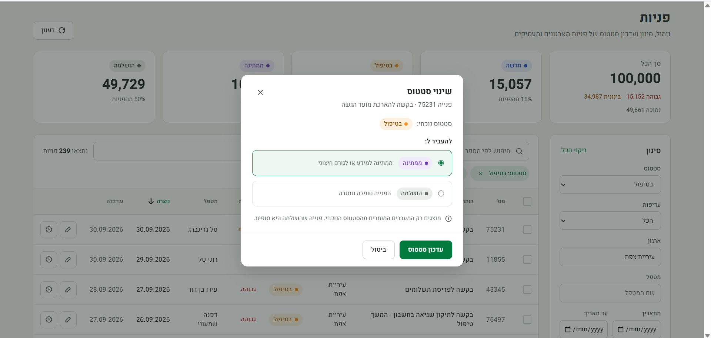 |
| Requests page: stats, search, filters, server-side paging | Status change: only the allowed targets |
| 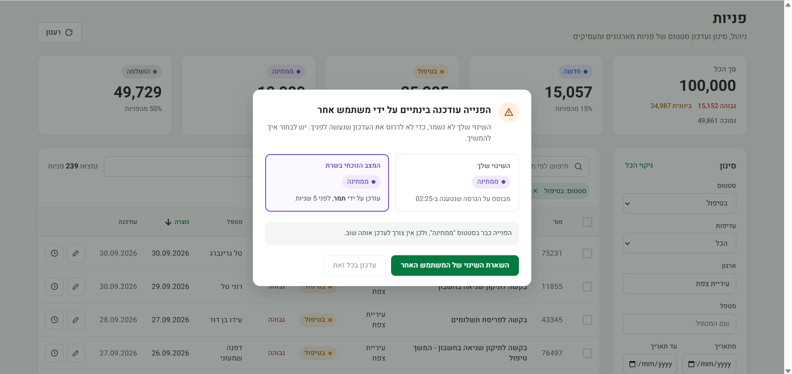 | 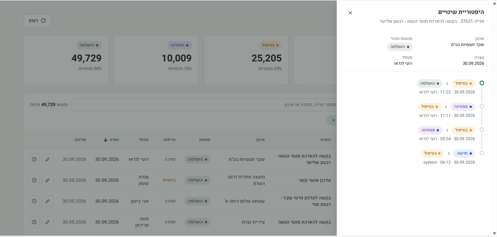 |
| Conflict (409): your change vs the current state on the server | History panel, newest first |
| 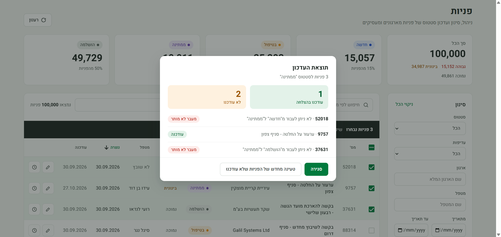 | 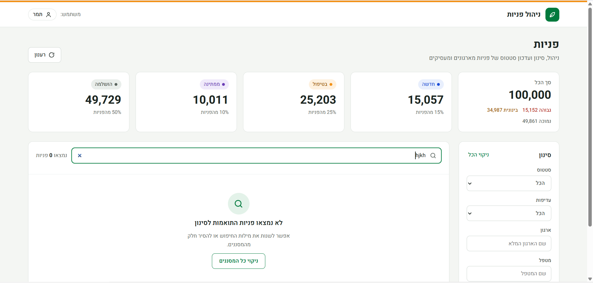 |
| Bulk update: result per request | Empty state |
| 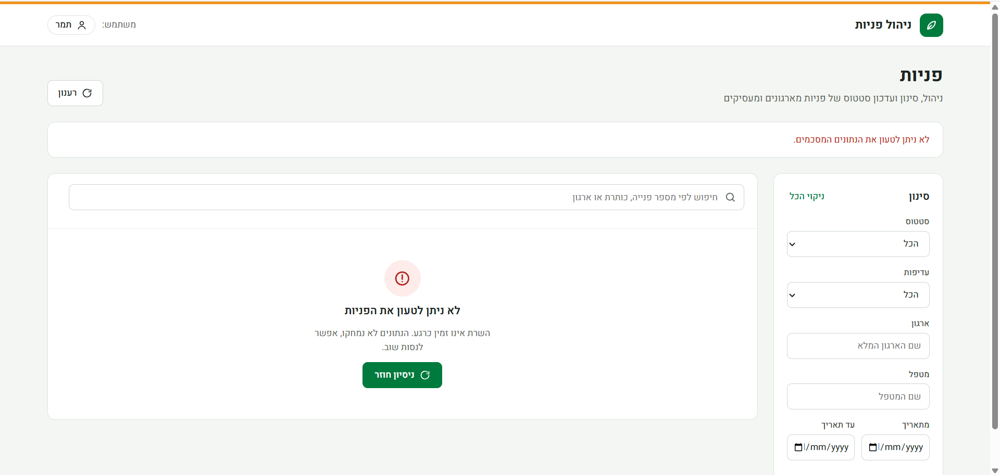 | 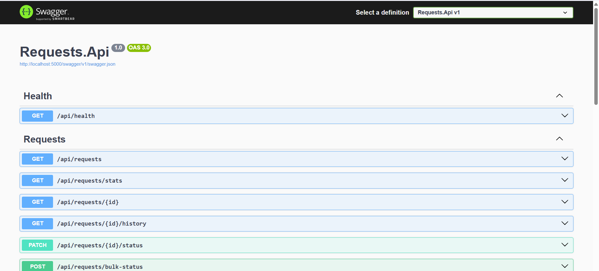 |
| Error state with retry | API in Swagger |
| 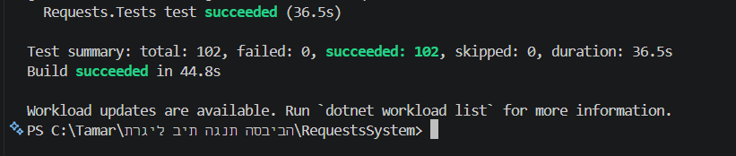 | |
| Backend and frontend tests passing | |

<details>
<summary>Execution plans before and after the indexes</summary>

From the [performance report](docs/performance/README.md):

| | Before | After |
|---|---|---|
| Q1 – default list |  |  |
| Q2 – status + priority |  |  |
| Q5 – stats |  |  |

</details>

The list of screenshot files is in [docs/images/README.md](docs/images/README.md).

## Design

The screens were designed first in **Claude Design** ([docs/design](docs/design), 6 screens: Main,
StatusDialog, Conflict, History, BulkResult, States) and then implemented with Angular components and
Angular Material. The implemented screens are in [Screenshots](#screenshots).

| Main | Status change | Conflict |
|---|---|---|
| 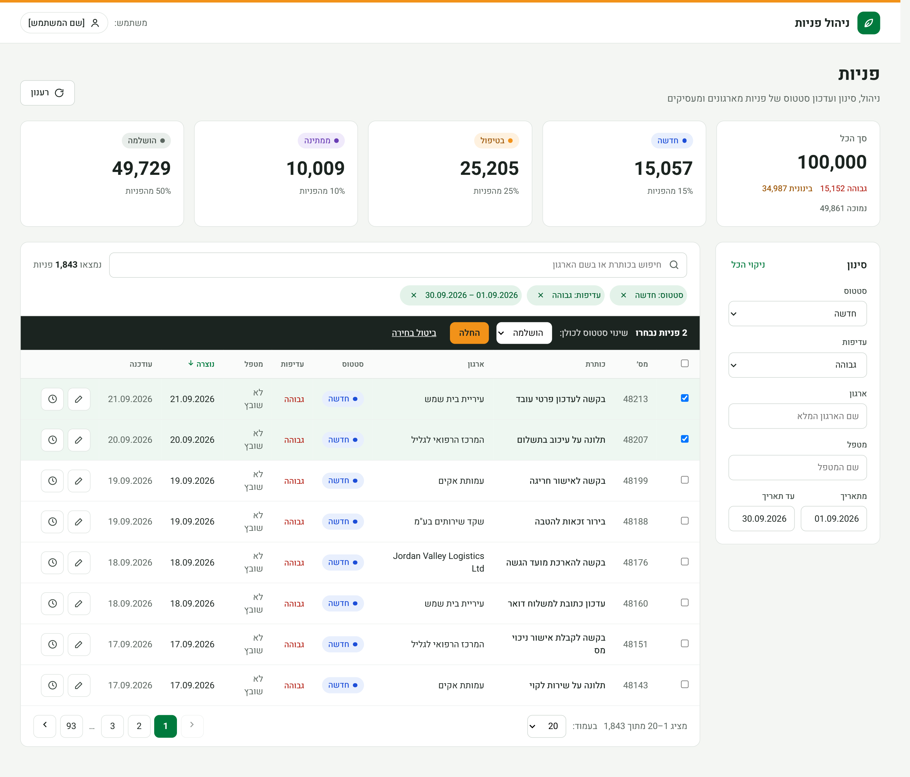 | 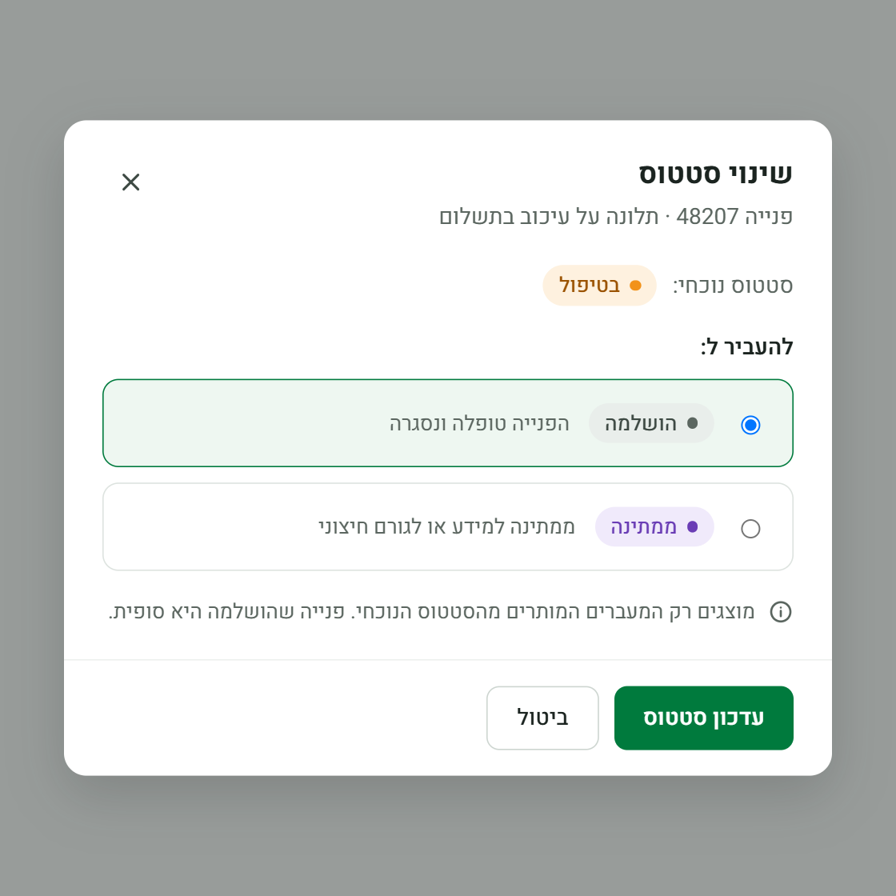 | 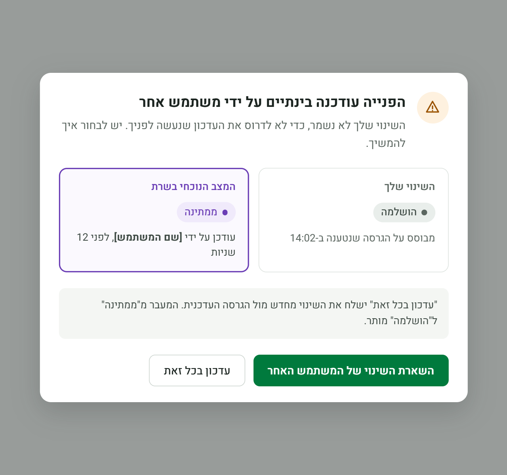 |
| **History** | **Bulk result** | **States** |
| 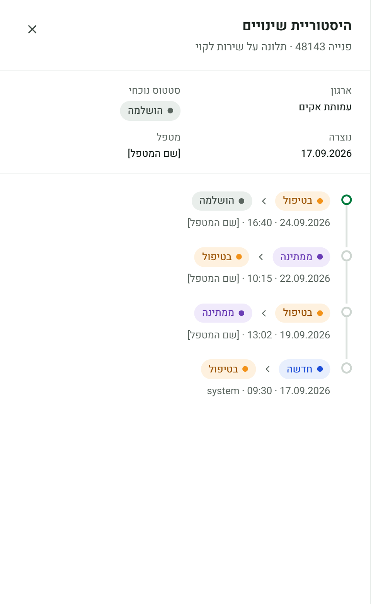 | 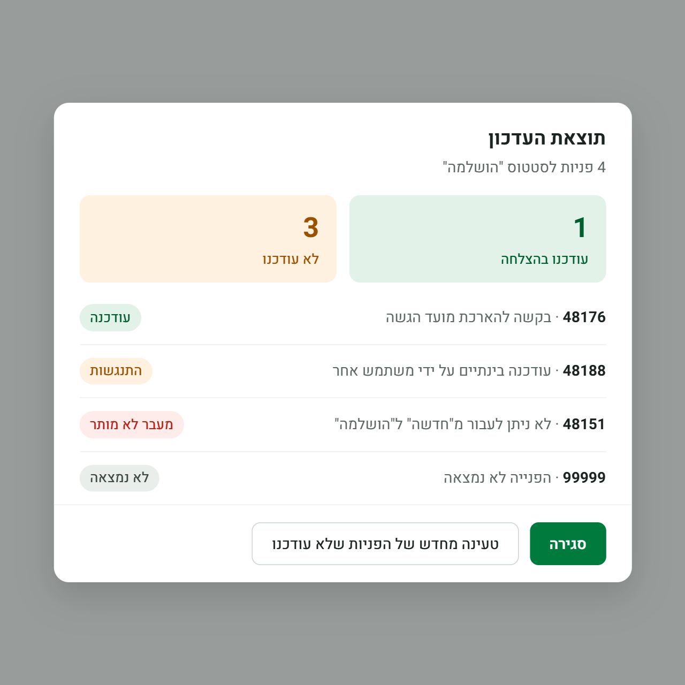 | 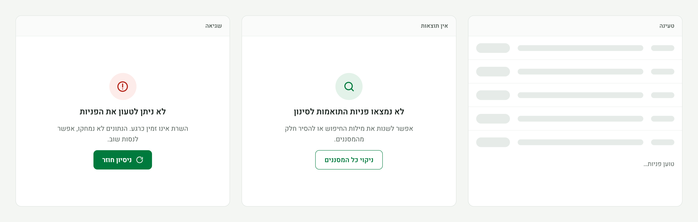 |

- **Colors** are taken from the leaves of the Ministry of Environmental Protection logo — green `#007A3D`
  and orange `#F29219` — without using the logo itself. All values are design tokens (CSS custom properties)
  in [`_tokens.scss`](frontend/src/styles/_tokens.scss); components use only `var(--token)`, and the Material
  theme (buttons, checkboxes, dialogs, snackbar, table, progress bar) is mapped to the same tokens
  ([decision 31](docs/decisions.md)).
- **Typography:** Heebo (Hebrew), sizes 12–30 px.

<details>
<summary>Accessibility</summary>

- Status meaning never depends on color alone: every badge has a dot **and** a text label, priorities are words.
- Text colors meet contrast on their backgrounds; the orange is **never used as text on white** — only as
  a surface with dark text (the bulk "החלה" button), the 4px header stripe, or a status dot.
- Real buttons and labels for every input, `aria-label` on icon buttons, dialogs with titles (the conflict
  dialog is an `alertdialog`), focus moves to the dialog title and returns to the triggering button on close,
  `aria-live` for the result count and loading states.
- The layout stacks on narrow screens; the wide table scrolls inside its own box, never the page.

</details>

## Architecture

The backend solution (`backend/RequestsSystem.sln`) has three layers plus a test project; the Angular
client is in `frontend/`.

| Project | Responsibility |
|---|---|
| `backend/src/Requests.Api` | Entry point only: ASP.NET Core Web API controllers, `Program.cs`, configuration, Swagger. No business logic. |
| `backend/src/Requests.BL` | Business logic: services, DTOs, validation (FluentValidation). Exposes `AddBl()` for DI registration. |
| `backend/src/Requests.DAL` | Data access: EF Core `AppDbContext`, entities, entity configurations, migrations. Exposes `AddDal()` for DI registration. |
| `backend/tests/Requests.Tests` | xUnit tests (unit and integration via `WebApplicationFactory` + Testcontainers). |

Dependency direction: `Api → BL → DAL`, and `Api → DAL` for DI wiring. DAL references neither BL nor Api; BL does not reference Api.

### Data model

- **Requests**: `Id`, `Title`, `OrganizationName`, `Status` (tinyint), `Priority` (tinyint), `AssignedTo`, `CreatedAt`/`UpdatedAt` (UTC), `RowVersion` (rowversion concurrency token).
- **RequestStatusHistory**: `Id`, `RequestId` (FK, cascade delete), `PreviousStatus`, `NewStatus`, `ChangedAt` (UTC), `ChangedBy`. Indexed on `(RequestId, ChangedAt)`.

See [docs/decisions.md](docs/decisions.md) for technical decisions.

### Project structure

<details>
<summary>Folder tree</summary>

```
RequestsSystem/
├── backend/
│   ├── RequestsSystem.sln
│   ├── Dockerfile             # API image (.NET 8 SDK build → ASP.NET Core 8 runtime)
│   ├── src/
│   │   ├── Requests.Api/      # HTTP entry point: controllers, Program.cs, configuration, startup options
│   │   ├── Requests.BL/       # Business logic: services, DTOs, validation, domain rules, cache
│   │   └── Requests.DAL/      # Data access with EF Core: DbContext, entities, migrations, repository, seeder
│   └── tests/
│       └── Requests.Tests/    # xUnit unit and integration tests
├── frontend/                  # Angular 21 client (see frontend/README.md)
│   ├── Dockerfile, nginx.conf # web image: Node build → nginx (serves the app, proxies /api)
│   ├── proxy.conf.json        # dev proxy: /api → http://localhost:5000
│   └── src/
│       ├── styles/            # design tokens (_tokens.scss), shared control and dialog styles
│       └── app/
│           ├── models/        # TypeScript types matching docs/api-contract.md
│           ├── services/      # HTTP client (RequestsApiService)
│           ├── core/          # cross-cutting: ApiError, error and X-User-Name interceptors, current user
│           ├── shared/        # labels, transitions, StatusBadge, PriorityLabel, icons, date helpers
│           └── features/
│               └── requests/  # RequestsListState, RequestStatusActions, components/ (page, table, dialogs…)
├── docs/                      # Technical decisions, work plan, API contract, AI usage
│   ├── design/                # UI design from Claude Design (*.dc.html and images, reference only)
│   ├── images/                # README screenshots
│   └── performance/           # performance report, queries, measurement script, execution plans
├── .github/workflows/ci.yml   # CI: backend build + tests, frontend tests + build
├── .config/                   # Local .NET tools manifest (dotnet-ef)
└── docker-compose.yml         # SQL Server 2022, API and web
```

</details>

## API

Seven REST endpoints under `/api`: a paged, filtered list, a single request, stats, status update, history,
bulk status update and a health check. Full specification in [docs/api-contract.md](docs/api-contract.md).

| Endpoint | Description |
|---|---|
| `GET /api/requests` | Paged list with filters (`status`, `priority`, `organizationName`, `assignedTo`, `createdFrom`/`createdTo`), free-text `search` on title or organization (a numeric search also matches the request number), sorting (`sortBy`, `sortDirection`) and paging (`page`, `pageSize` ≤ 100). `400` on invalid parameters. |
| `GET /api/requests/{id}` | A single request, or `404`. |
| `GET /api/requests/stats` | Counts over all requests: total, per status and per priority. |
| `PATCH /api/requests/{id}/status` | Changes the status, with optimistic concurrency on `version` (see [Concurrency](#concurrency)). `200` updated request, `400` invalid body or transition, `404`, `409` with the current state. Optional `X-User-Name` header for the audit row. |
| `GET /api/requests/{id}/history` | Status change history, newest first, or `404`. |
| `POST /api/requests/bulk-status` | Changes the status of 1–100 requests with partial success (see [Bulk Update](#bulk-update)). `200` with a result per item whenever the request is valid; `400` for an invalid request (nothing changed). |
| `GET /api/health` | Liveness check (also the Docker healthcheck). |

Enums are strings, dates are UTC ISO 8601, `version` is the Base64 `rowversion`, and every error is an
RFC 7807 ProblemDetails (`400` responses include an `errors` object keyed by the camelCase parameter name).

[backend/src/Requests.Api/Requests.http](backend/src/Requests.Api/Requests.http) contains runnable
examples for every endpoint, including invalid input (open it in VS Code with the REST Client extension,
or in Visual Studio / Rider).

## Frontend

One Hebrew RTL screen in Angular 21 (standalone, zoneless) + Angular Material, in [frontend/](frontend/README.md).
All searching, filtering, sorting and paging happens on the server; RxJS debounces the inputs and cancels
outdated requests.

<details>
<summary>How the screen meets each requirement</summary>

| Requirement | How the screen does it |
|---|---|
| Server-side search, filter, sort, paging | Every change builds a query for `GET /api/requests`; only the current page (20/50/100 rows) is loaded, never all rows. Sortable columns: created, updated, priority, title, organization. |
| Debounce | Search, organization and handler inputs: `debounceTime(300)` + `distinctUntilChanged` — typing "בנק" sends one request. |
| Request cancellation | `switchMap`: a newer query aborts the request in flight (shown as *canceled* in the network log); a stale response can never replace a newer one. |
| Loading / empty / error states | Skeleton rows; "לא נמצאו פניות…" with "ניקוי כל המסננים"; error with "ניסיון חוזר" that tells "server unreachable" apart from other errors. Refreshing after an update keeps the rows and shows a thin progress bar. |
| Status update with 409 handling | Status dialog with only the allowed targets; on `409` a conflict dialog (see [Conflict handling in the UI](#conflict-handling-in-the-ui)). |
| Stats | Cards for the total (with priority breakdown) and per status (count and share), reloaded after every successful update. |
| History | Side panel with the request summary and a timeline, newest first. |
| Bulk | Row selection (current page), target status, per-item result dialog; "טעינה מחדש של הפניות שלא עודכנו" keeps the failed items selected. |
| Shareable state | The query is kept in the URL (`?status=Waiting&sortBy=priority…`), so refresh and links keep it. |

</details>

Run: start the API, then `cd frontend && npm install && npm start` and open http://localhost:4200.
Tests: `cd frontend && npm test` (Vitest, single headless run).

### Frontend architecture

<details>
<summary>Components, state streams, errors, current user and serving</summary>

- **Container vs presentational components.** `requests-page` is the only container: it injects the state and
  the actions, opens dialogs, and passes data down. `stats-cards`, `requests-filters`, `active-filters`,
  `bulk-action-bar`, `requests-table`, `requests-paginator` and `list-state` only take inputs and emit outputs.
- **`RequestsListState`** (provided in the page, so it lives and dies with it) owns the search `FormControl`,
  the filters `FormGroup`, the selection, and three streams:

  ```
  search / org / handler  → trim → debounceTime(300) → distinctUntilChanged ┐
  status / priority / dates (date range validated) ─────────────────────────┤ → scan(reducer) → distinctUntilChanged
  sort / page / page size / clear-all / remove-chip commands ───────────────┘       (any criteria change → page 1)
      → query$ ─┬→ URL (replaceUrl)
                └→ switchMap(getRequests) → map(ready) / catchError(error) / startWith(loading) → vm$
  refresh() ───────→ (same query) ─┘
  ```

  The inputs are folded by a `scan` reducer (rather than a plain `combineLatest`) so that multi-field changes
  such as "clear all" and the reset to page 1 are **one** query, never a request that is immediately
  cancelled. `catchError` is inside the `switchMap`, per request, so an error never ends the stream. The
  stats are a separate stream, reloaded after every successful update.
- **Why no NgRx:** one screen with local state; a component-level service with RxJS is enough
  ([decision 27](docs/decisions.md)).
- **`RequestStatusActions`** holds the update flows (single, conflict, bulk) and their side effects
  (snackbar, list and stats refresh), so the components stay simple and the flow is unit-tested.
- **Errors:** the HTTP interceptor turns every failure into an `ApiError` and rethrows it; it never shows
  messages. `400` shows the server's `detail` in a snackbar, `404` on update shows "הפנייה לא נמצאה" and
  refreshes, and the list shows the error state. A `5xx` without a ProblemDetails body (the dev proxy when the
  API is down) counts as "server unreachable".
- **Current user:** the user chip in the header edits the name (kept in `localStorage`). An interceptor sends
  it on every `/api` request as `X-User-Name`, percent-encoded because browsers refuse Hebrew header values;
  the API decodes it and stores it as `changedBy` ([decision 32](docs/decisions.md)).
- **Serving:** in development the Angular dev server proxies `/api` to the API; in Docker, nginx serves the
  built app and proxies `/api` to the API container. In both cases the app calls relative `/api` URLs on the
  same origin, so no CORS is needed ([decisions 9 and 36](docs/decisions.md)).

</details>

### Conflict handling in the UI

On a `409` the user sees their change next to the current state on the server, and decides whether to keep
the other user's change or apply theirs anyway (screenshot: *Conflict* in [Screenshots](#screenshots)).

<details>
<summary>The flow step by step</summary>

1. The user opens "שינוי סטטוס" on a row; the dialog shows the current status and only the allowed targets.
2. The client sends `PATCH /api/requests/{id}/status` with the `version` of the row it loaded.
3. If someone changed the request in the meantime, the server answers `409` with the current state under
   `current`. Nothing was saved.
4. The conflict dialog shows **"השינוי שלך"** (the attempted status, and when the user's version was loaded)
   next to **"המצב הנוכחי בשרת"** (`current.status`). It loads the request history and shows who made the
   winning change and how long ago (newest history entry, e.g. "עודכן על ידי דנה לוי, לפני 12 שניות").
5. The user decides:
   - **"השארת השינוי של המשתמש האחר"** — nothing is sent; the row is updated with `current`.
   - **"עדכון בכל זאת"** — the change is sent again with `current.version`. If the transition is not allowed
     from the current status (or it already has that status), the button is disabled and the note explains why.
     Another `409` opens the dialog again.
6. After a successful update the list and the stats are refreshed (the user stays on the same page) and a
   short snackbar confirms it.

</details>

## Database & Indexes

SQL Server 2022, schema created by EF Core migrations (`InitialCreate`, `AddRequestIndexes`). Every index
was chosen from a measured query and verified in its actual execution plan
([performance report](docs/performance/README.md)).

<details>
<summary>The indexes and the scenario each one serves</summary>

| Index | Columns | Scenario |
|---|---|---|
| `PK_Requests` (clustered) | `Id` | Get by id, status update (`WHERE Id = … AND RowVersion = …`), bulk load (`WHERE Id IN …`) |
| `IX_Requests_CreatedAt` | `CreatedAt DESC, Id DESC` | Sorting: the default list order (`createdAt desc`) without filters; first page of a search |
| `IX_Requests_Status_CreatedAt` | `Status, CreatedAt DESC, Id DESC` | Filter by status, sorted by the default order |
| `IX_Requests_AssignedTo` | `AssignedTo, CreatedAt DESC, Id DESC` | Filter by handler, sorted by the default order |
| `IX_Requests_OrganizationName` | `OrganizationName, CreatedAt DESC, Id DESC` | Filter by organization, sorted by the default order |
| `IX_Requests_Status_Priority` | `Status, Priority` | Stats (one narrow scan instead of the table); status + priority counts; the unfiltered COUNT |
| `IX_RequestStatusHistory_RequestId_ChangedAt` | `RequestId, ChangedAt` | History of one request, newest first |

- Composite indexes end with `Id`, in the same direction as the sort, matching the stable sort with `Id` as
  tie-breaker. The first page is read in order straight from the index, with no Sort operator.
- **Search** (`LIKE '%term%'` on `Title` / `OrganizationName`) cannot use a B-tree index. Its first page
  benefits from `IX_Requests_CreatedAt`, but its COUNT scans the table (see [Performance](#performance)).
- No filtered index for open requests: SQL Server cannot use it for the parameterized queries EF sends
  (verified in the plan, see [decision 25](docs/decisions.md)).
- Other sort fields (`updatedAt`, `priority`, `title`, `organizationName`) have no dedicated index. They are
  less common choices; each would cost another index on every write.

</details>

### Avoiding loading all data into memory

- Filtering, search, sorting and paging are composed on one `IQueryable` in `RequestRepository` and
  executed by SQL Server: one query with `ORDER BY … OFFSET … FETCH NEXT` for the page, plus one
  `COUNT(*)` query with the same `WHERE` for `totalCount`. Nothing is materialized before paging.
- Queries use `AsNoTracking`, so EF Core does not build change-tracking state for read-only data.
- Only the current page (at most 100 rows, enforced by validation) leaves the database.
- Stats are computed in SQL by a single aggregate query (`COUNT(*)` plus conditional
  `COUNT(CASE WHEN …)` per status and priority), one pass over the table instead of one query per group.
- The indexes above let SQL Server read only the first rows of the page in order (e.g. 70 pages for the
  default list instead of the whole table), instead of sorting all matching rows.

## Concurrency

The database itself rejects an update based on a stale version, and the API answers `409` with the current
state.

Status updates use **optimistic concurrency** with the SQL Server `rowversion` column (`RowVersion`), which
SQL Server changes automatically on every update of the row. Every `RequestDto` carries it as `version`
(Base64), and the client sends back the version it saw in `PATCH /api/requests/{id}/status`.

**The database enforces the check.** The repository sets the version from the client as the *original*
value of `RowVersion`, so EF Core generates:

```sql
UPDATE [Requests] SET [Status] = @p5, [UpdatedAt] = @p6
OUTPUT INSERTED.[RowVersion]
WHERE [Id] = @p7 AND [RowVersion] = @p8;
```

If someone else changed the row in the meantime, the `WHERE` matches no row, EF Core raises
`DbUpdateConcurrencyException`, nothing is saved (including the history row, which is in the same
transaction), and the API returns `409`. The check in code that compares versions right after loading
the request is only a shortcut that avoids a pointless `UPDATE`. Correctness does not depend on it, nor
on the UI: two requests sent at exactly the same moment are serialized by SQL Server, and only one
`UPDATE` matches (covered by an integration test that sends two `PATCH` calls in parallel with
`Task.WhenAll`).

<details>
<summary>What the client receives on 409, and how <code>UpdatedAt</code> / <code>RowVersion</code> change</summary>

**What the client receives on 409.** ProblemDetails with the title "The request was modified by another
user" and the current state under `current` (a full `RequestDto` with the new `version`). The client
should show the user what changed and, if the user still wants the change, send it again with
`current.version`. This prevents **lost updates**: a change based on stale data can never silently
overwrite someone else's change.

`UpdatedAt` and `RowVersion` change on every update: `UpdatedAt` is set centrally in
`AppDbContext.SaveChanges` for every modified request, so no code path can forget it; `RowVersion` is
set by SQL Server. The seeder writes with `SqlBulkCopy`, bypasses `SaveChanges`, and keeps its generated
`UpdatedAt` values.

</details>

### Status transitions

| From | Allowed to |
|---|---|
| `New` | `InProgress` |
| `InProgress` | `Waiting`, `Completed` |
| `Waiting` | `InProgress`, `Completed` |
| `Completed` | – (final) |

Changing a status to itself is not allowed. The rules (`StatusTransitions` in the BL) match the history
paths of the seeded data.

**Auto-assignment.** When a request is taken into work (`New` → `InProgress`) and has no handler, the user
who made the change (from `X-User-Name`, the same value stored as `ChangedBy`) becomes its handler, so an
in-progress request always has one, as in the seeded data. `"anonymous"` assigns nobody, and an existing
handler is never overwritten. The rule (`AutoAssignment` in the BL) runs in the shared code of the single and
the bulk update, and the handler is saved in the same `SaveChanges` as the status and the history row, so it
is protected by the same `RowVersion` check: a conflict assigns nobody.

### Order of checks in `PATCH …/status`

<details>
<summary>Validation → existence → version → transition → save</summary>

1. Body is valid (`newStatus` known, `version` is Base64 of 8 bytes), otherwise `400` with `errors`.
2. The request exists, otherwise `404`.
3. `version` equals the current version, otherwise `409` with `current`. This comes before the transition
   rule: with stale data a transition error would be misleading.
4. The transition is allowed, otherwise `400` "Invalid status transition", with a message that names both
   statuses and the allowed targets.
5. Save. If the database rejects the version (someone saved in between), the current state is reloaded and
   the result is `409` with `current`.

</details>

### Audit history

Every successful status change adds a `RequestStatusHistory` row: `RequestId`, `PreviousStatus`,
`NewStatus`, `ChangedAt` (UTC) and `ChangedBy` (from the `X-User-Name` header, `"anonymous"` if missing).
The row is added in the same `SaveChanges` call as the status change, so both are written in one
transaction: there is never a change without an audit row, or an audit row without a change. A rejected
update (`409`, `400`) writes nothing.

`GET /api/requests/{id}/history` returns the rows newest first (`ChangedAt` descending, then `Id`
descending). It uses the existing index on `(RequestId, ChangedAt)`.

## Bulk Update

`POST /api/requests/bulk-status` changes the status of up to 100 requests in one call, with **partial
success**: every item succeeds or fails on its own.

**Why partial success?** The items are independent requests, each with its own version. One request that
someone else changed in the meantime should not block 99 valid updates, and with all-or-nothing the user
would have to fix and resend the whole batch without knowing which items were the problem. With partial
success the client sees exactly what failed and why, and can retry only those items.

**Two levels of errors:**

- *Request-level* (`400` ValidationProblemDetails, nothing touched in the database): missing or unknown
  `newStatus`, empty list, more than 100 items, duplicate ids, a `version` that is not Base64 of 8 bytes.
- *Item-level* (inside a `200` response): `NotFound`, `Conflict` (stale version, or someone saved in between)
  and `InvalidTransition` (with a message naming the current status, the requested one and the allowed targets).

**How it runs.** All requests are loaded with **one query** (`WHERE Id IN (…)`). Then each item, in input
order, goes through the same code as the single `PATCH`: exists → version → transition → save. Each
successful item is saved with **its own `SaveChanges`, so its own transaction**, which writes the status
change and its **audit history row** together (`ChangedBy` from `X-User-Name`). A save that fails because of
a concurrency conflict detaches that request and its pending history row, so the next item in the same
`DbContext` is not affected. The stats cache is invalidated once at the end, only if at least one item
was updated.

<details>
<summary>Example response, and why <code>200</code> and not <code>207</code></summary>

Example response (one item of each outcome, results in the order of the request):

```json
{
  "succeeded": 1,
  "failed": 3,
  "results": [
    { "id": 77048, "outcome": "Updated", "version": "AAAAAAAGKIo=" },
    { "id": 999999, "outcome": "NotFound", "message": "Request 999999 does not exist." },
    { "id": 4088, "outcome": "Conflict", "message": "The request was modified by another user." },
    { "id": 49769, "outcome": "InvalidTransition", "message": "Cannot change status from Completed to Completed. Allowed from Completed: none (Completed is final)." }
  ]
}
```

**Why `200` and not `207 Multi-Status`?** `207` comes from WebDAV and is poorly supported by HTTP clients
and tooling (many treat it as plain success anyway). The request itself was processed successfully, and the
body already carries the outcome of every item, plus `succeeded` / `failed` counts.

</details>

## Cache

Only the stats are cached, in `IMemoryCache` behind `IStatsCache`, with a 60-second absolute expiration and
invalidation after every successful update.

**What is cached:** only the stats (`GET /api/requests/stats`). They are an aggregate over the whole table,
which is expensive. They are identical for all users and read on every page load, and a few seconds of
staleness in summary counts is harmless. The list is not cached: with free-text search, filters, sorting
and paging, almost every query is different, so the hit rate would be near zero.

**How:** `IStatsCache` (BL) with the implementation `MemoryStatsCache` over `IMemoryCache`, registered as a
singleton. It never captures scoped services: the factory that queries the database is passed in on every
call. Expiration is **absolute**, 60 seconds by default (`Cache:StatsSeconds` in `appsettings.json`), so the
stats are never older than that. Sliding expiration would keep a frequently read value alive forever.

**Invalidation:** after every successful single status change, and after a bulk update when at least one
item was updated. It happens **only after the save succeeded**, never before: invalidating first would let
a concurrent read re-cache the old values before the change is committed. Hits, misses and invalidations
are logged at Debug (enabled in `appsettings.Development.json`).

<details>
<summary>Known race, and running several instances</summary>

**Known race:** a stats read that started *before* an update can finish *after* the invalidation and put the
old values back in the cache. The absolute expiration bounds this: the stale value lives at most 60 seconds.

**Multiple instances:** each instance would have its own memory cache, and an invalidation on one instance
would not reach the others. The fix is a Redis implementation of `IStatsCache` (over `IDistributedCache`),
plus either broadcasting the invalidation to all instances (e.g. Redis pub/sub) or versioned keys (a
counter in Redis that is incremented on every change and is part of the cache key). Thanks to the interface,
no other code changes.

</details>

## Performance

Measured on the 100,000 seeded requests with the exact SQL EF Core sends, before and after the indexes
(logical reads, `STATISTICS TIME`, actual execution plans, and API response times). Full report with plans:
**[docs/performance/README.md](docs/performance/README.md)**.

| Operation | Logical reads before → after | API median before → after |
|---|---:|---:|
| Default list, page 1 (`GET /api/requests`) | 2,134 → 70 (page) + 2,030 → 152 (COUNT) | 54 → 15.9 ms |
| Status + priority filter | 2,030 → 418 (page) + 2,030 → 8 (COUNT) | 43.4 → 10.3 ms |
| Stats, uncached | 2,030 → 152 | 50 → 38.7 ms |
| Filter by handler / organization (page) | 2,030 → 71 / 72 | – |

<details>
<summary>Findings, bottlenecks and how to reproduce</summary>

- **Indexes added:** `IX_Requests_CreatedAt`, `IX_Requests_Status_CreatedAt`, `IX_Requests_AssignedTo`,
  `IX_Requests_OrganizationName`, `IX_Requests_Status_Priority` (see [Database & Indexes](#database--indexes)).
  Plans changed from *Clustered Index Scan + Sort* to *Index Seek / ordered Index Scan + 20 Key Lookups*.
- **Main bottleneck: text search.** `LIKE '%term%'` scans the whole table for the COUNT in both runs
  (2,030 reads, ~350 ms), which is >99% of a search request. Proposed: SQL Server Full-Text Search
  (`CONTAINS`), or "has more" instead of an exact total for searches.
- **Search by request number** (`OR Id = @id` in the same `WHERE`) adds no measurable cost: the search
  remains a scan, with identical reads before and after (COUNT 2,030; page 306,706) and times within
  run-to-run noise. A number, like any search term with few matches, makes the page query walk the whole
  `IX_Requests_CreatedAt` with a key lookup per row (~0.35–0.45 s); see the
  [report](docs/performance/README.md#search-by-request-number).
- **Deep paging:** page 4000 reads 245,185 pages (a plan reused from page 1 does 80,000 Key Lookups) vs 70
  for page 1. Proposed: keyset pagination, measured at 72 reads for the same page.
- **Write cost:** 5 more indexes on `Requests` (~15 MB). A status update maintains only the two that contain
  `Status` (6 → 29 reads, still under 1 ms).

Reproduce: seed (`dotnet run --project backend/src/Requests.Api -- --seed`), start the API with
`Cache__StatsSeconds=0`, then run `./docs/performance/measure.ps1 -Label before` on a database with only the
primary key (`dotnet ef database update InitialCreate …`) and `-Label after` with all migrations applied.
Details in the [report](docs/performance/README.md#how-to-reproduce).

</details>

## Running tests

Backend unit and integration tests (on a real SQL Server in Docker) and Angular tests; CI runs all of them on
every push.

```bash
dotnet test backend/RequestsSystem.sln

cd frontend && npm test   # Angular tests, single headless run
```

The backend tests include unit tests (no dependencies) and **integration tests that need Docker running**:
they start a throwaway SQL Server 2022 container with Testcontainers (once for all integration tests),
apply the migrations, seed 500 deterministic requests and call the API over HTTP through
`WebApplicationFactory`. The first run also pulls the SQL Server image if it is not present.

The same tests run in [CI](.github/workflows/ci.yml) on every push and pull request to `main`: the backend
job builds and runs all backend tests (Docker is available on the GitHub runner for Testcontainers), and
the frontend job runs `npm test` and the production build.

## Local development

Only the database runs in Docker; the API and the UI run on the host, for debugging and hot reload.

### Prerequisites

- [.NET 8 SDK](https://dotnet.microsoft.com/download/dotnet/8.0) (or newer SDK with the .NET 8 runtime)
- [Docker](https://www.docker.com/) (Docker Desktop on Windows/macOS)
- [Node.js](https://nodejs.org/) LTS – developed with Node 24.12.0 and npm 11.6.2 (Angular 21 requires Node `^20.19`, `^22.12` or `>=24`)

### How to run

All commands are run from the `RequestsSystem` folder (the repository root). Only the database runs in
Docker; the API and the UI run on the host.

```bash
# 1. Local secrets (first time only; optional, docker-compose.yml has the same default)
cp .env.example .env

# 2. Start SQL Server 2022 only, and wait until it is healthy
docker compose up -d sqlserver

# 3. Restore local tools (dotnet-ef) and apply migrations
dotnet tool restore
dotnet ef database update --project backend/src/Requests.DAL --startup-project backend/src/Requests.Api

# 4. Generate test data (100,000 requests; see "Test Data" below)
dotnet run --project backend/src/Requests.Api -- --seed

# 5. Run the API
dotnet run --project backend/src/Requests.Api
```

- API: http://localhost:5000
- Swagger UI: http://localhost:5000/swagger
- Health check: `GET http://localhost:5000/api/health` → `200 { "status": "ok" }`

> SQL Server from Docker is exposed on host port **1435** (not 1433) so it does not collide with a
> locally installed SQL Server instance, which typically uses TCP 1433 and its DAC on 1434.
>
> Use `docker compose up -d sqlserver`, not `docker compose up`, for local development: the full stack
> would also start the `api` and `web` containers on ports 5000 and 4200.

Run the frontend (in a second terminal, while the API is running):

```bash
cd frontend
npm install
npm start
```

Then open http://localhost:4200 (the API must be running). The dev server proxies `/api` to the API on
port 5000. See [Frontend](#frontend).

To run the tests, see [Running tests](#running-tests).

## Test Data

A deterministic seeder: 100,000 requests and ~178,000 history rows with realistic, skewed distributions,
inserted with `SqlBulkCopy` in seconds.

Generate test data (SQL Server must be running and migrations applied):

```bash
dotnet run --project backend/src/Requests.Api -- --seed               # 100,000 requests (default)
dotnet run --project backend/src/Requests.Api -- --seed --count 5000  # any count from 1 to 1,000,000
```

The command fills the database and exits without starting the web server. It **deletes all existing
requests and history first**, so running it again recreates exactly the same data: generation uses a
fixed random seed (42) and a fixed reference date (2026-10-01 UTC), never the current time.

<details>
<summary>What is generated, the distributions, and why SqlBulkCopy</summary>

What is generated (code in `backend/src/Requests.DAL/Seeding/`):

- **100,000 requests** with Ids 1..100,000, Hebrew titles, 300 organizations (municipalities, regional
  councils, hospitals, NGOs, companies; Hebrew and English) and 50 handlers.
- **~178,000 status history rows**: every non-`New` request has a consistent path from `New` to its
  current status, with strictly increasing `ChangedAt` between `CreatedAt` and the reference date.
  `UpdatedAt` equals the last change.

| Field | Distribution |
|---|---|
| `Status` | Completed 50%, InProgress 25%, New 15%, Waiting 10% |
| `Priority` | Low 50%, Medium 35%, High 15% |
| `OrganizationName` | Skewed: 20% of organizations (60) receive ~60% of requests |
| `AssignedTo` | `null` for `New`; otherwise one of 50 handlers |
| `CreatedAt` | Uniform within the 2 years before the reference date |
| History path | InProgress: New→InProgress · Waiting: New→InProgress→Waiting · Completed: New→InProgress→Completed, or (1 in 3) New→InProgress→Waiting→InProgress→Completed |

**Why skewed distributions?** Real data is never uniform. Index selectivity depends on the actual value
distribution: filtering by `Status = Waiting` (10%) behaves differently from `Status = Completed` (50%),
and a "big" organization returns many more rows than a small one. Realistic skew makes the index and
performance measurements meaningful instead of optimistic.

**Why SqlBulkCopy?** Inserting ~280,000 rows through EF Core (`AddRange` + `SaveChanges`) means change
tracking and batched `INSERT` statements and takes minutes. `SqlBulkCopy` streams the rows with the
bulk-load protocol inside one transaction. Measured on the local Docker SQL Server before the indexes were
added: generation ~0.4 s, insert ~2.8 s on an empty database (~7.4 s when existing data is deleted first);
the whole command finished in under 10 seconds. With the five indexes the insert takes ~13–16 s
([performance report](docs/performance/README.md#write-cost-of-the-indexes)).

</details>

## Technical Decisions

The most important decisions; the full list (37 decisions, each with its reason and alternatives) is in
[docs/decisions.md](docs/decisions.md).

| Decision | Why | Alternative |
|---|---|---|
| **SQL Server + `rowversion`** for optimistic concurrency | The database itself rejects a stale update in the `WHERE` of the `UPDATE`, not only the code or the UI; execution plans make the performance work measurable | PostgreSQL / MongoDB; a manual version number column |
| **Three layers (Api / BL / DAL)** with a specific repository | Clear responsibilities without over-engineering; all request queries in one place for the performance work | Clean Architecture with 4+ projects, CQRS / MediatR; a generic repository |
| **Bulk update with partial success, one transaction per item** | Items are independent: one conflict must not block 99 valid updates, and the client sees exactly what failed | All-or-nothing in one transaction; `207 Multi-Status` |
| **`IMemoryCache` behind `IStatsCache`**, absolute expiration + invalidation after every successful update | Stats are an expensive aggregate, identical for all users; changes show immediately, staleness is bounded by 60 s; Redis can replace it without other code changes | Redis from the start; caching the list (near-zero hit rate) |
| **Indexes chosen by measured queries** | Every index speeds specific reads and slows every write; only indexes used by a measured query (verified in the actual plan) are kept | One index per filterable column; a filtered index for open requests (measured: unusable with parameterized queries) |

## Known Limitations

- **`ChangedBy` comes from a client header (`X-User-Name`)**, because there is no authentication. Any
  client can send any name. In a real system it would come from the authenticated user (e.g. a claim of a
  validated JWT), not from a header the client controls. Because browsers refuse non-ASCII header values,
  the client percent-encodes the name and the API decodes it ([decision 32](docs/decisions.md)).
- **No creating, editing or deleting requests.** They are not part of the assessment; all requests come from
  the seeder. A possible extension is `POST /api/requests` with validation (FluentValidation, as for the other
  inputs) that also writes a first history row (`New`), in the same transaction.
- **No screen for (re)assigning a handler.** A handler is set only automatically, when a request is taken
  into work ([Auto-assignment](#status-transitions)); changing or removing it is out of the scope of the
  assessment and would need its own endpoint and UI.
- **Date filters use UTC days**, while the table shows local dates: a request created on 05.09 at 01:00
  Israel time (04.09 22:00 UTC) is shown as 05.09 but matches the filter day 04.09.
- **Bulk update saves each item separately**: up to 100 `SaveChanges` round trips (plus one reload per
  save-time conflict). This keeps partial success simple and correct. A possible improvement is a single
  batched save with per-entry conflict handling (detach the failed entries and retry the rest), or a
  set-based SQL `UPDATE … WHERE Id = … AND RowVersion = …` with `OUTPUT` that returns which rows changed,
  and writes the history rows in the same statement batch.
- **Stats cache is per instance** (see [Cache](#cache)); running several API instances needs the Redis
  implementation of `IStatsCache`.
- **Search scans the table** (`LIKE '%term%'`), and its COUNT costs ~350 ms on 100,000 rows; Full-Text Search
  or "has more" instead of an exact total would fix it ([performance report](docs/performance/README.md)).
- **Deep pages are slow** with `OFFSET` (page 4000: 245,185 reads vs 70 for page 1); keyset pagination would
  make every page cost the same, at the price of no random page jumps.

## AI Usage

- **Claude Code** generated the implementation step by step from written instructions (backend, frontend,
  tests, measurement scripts, Docker and CI) and the documentation drafts, and ran the builds, the tests and
  the measurements of each step.
- **Claude Design** produced the UI design and its design system ([docs/design](docs/design)); the colors come
  from the leaves of the Ministry of Environmental Protection logo.
- **Decided by me:**
  - **Architecture and technology:** three layers with interfaces only for the services and the repository;
    SQL Server (built-in `rowversion` and execution plans), after comparing MongoDB and PostgreSQL; Angular 21
    LTS rather than 22; the API contract first, so the frontend could be built in parallel; design tokens from
    the start.
  - **Behavior:** the status transition rules; partial success for bulk; `IMemoryCache` rather than Redis; stats
    over all requests rather than per filter, so they can be cached.
  - **Product:** auto-assignment of the handler instead of a full assignment feature; search by request number
    but not by more text fields; no creating, editing or deleting of requests.
  - **Design:** the screens were designed in Claude Design with the colors of the logo's leaves, and I approved
    the deviations in the implementation.
  - **Seed data:** its requirements, and approving fixed history Ids so that repeated runs give identical data.
- **Checked by me:**
  - The seeded data in the database.
  - The endpoints in Swagger against 100,000 rows.
  - A conflict from two browser tabs.
  - The execution plan diagrams against the measurements.
  - The Docker run, the screenshots and the passing tests (102 backend, 14 Angular).
- **Problems I traced:**
  - A "הפנייה לא נמצאה" error in the UI, traced to an old API process from before the status update step
    still running on port 5000.
  - A full disk that stopped Docker.
  - A font that the Docker build could not download behind NetFree.

The per-step details — what was generated and what was reviewed or decided manually — are in
[docs/ai-usage.md](docs/ai-usage.md).
