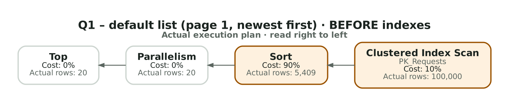
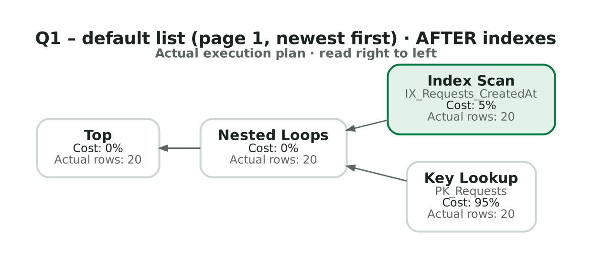
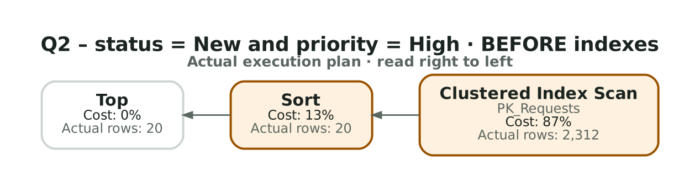
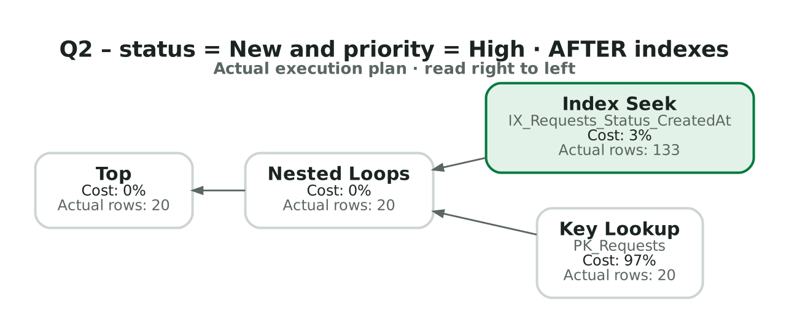
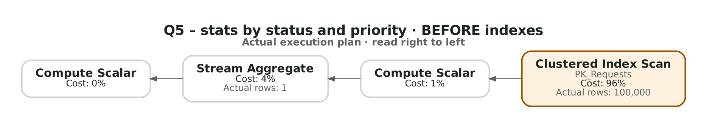
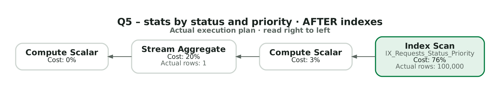

# Performance report: indexes and query measurement

Tasks T1.3 (indexes) and T9.1–T9.3 (measurement, index tuning, bottlenecks). Raw results:
[results-before.md](results-before.md), [results-after.md](results-after.md),
[results-filtered-index.md](results-filtered-index.md), [results-bottlenecks.md](results-bottlenecks.md).
Actual execution plans: [plans/](plans/) (`.sqlplan`, open them in SSMS or the VS Code mssql extension).

## Method

- **Dataset:** 100,000 requests and 177,855 history rows from the deterministic seeder (fixed random seed 42,
  fixed reference date), so every run and every machine measures the same data. The distributions are skewed
  (Completed 50% … Waiting 10%; 20% of organizations hold 60% of requests), so selectivity is realistic.
- **Queries:** the SQL that EF Core actually sends, taken from the SQL Server plan cache after calling each
  endpoint once ([queries.sql](queries.sql)): same text, same `sp_executesql` parameter declarations
  (`tinyint`, `nvarchar(100)`, `nvarchar(200)`, `int`). Parameterization matters, because the plan is compiled for
  `Status = @p`, not for a literal.
- **Tools:** [measure.ps1](measure.ps1) runs every query through `sqlcmd` inside the container with
  `SET STATISTICS IO, TIME ON` (5 runs, median CPU and elapsed time) and once with `SET STATISTICS XML ON` to save
  the actual plan. It also times the API end to end (median of 20 HTTP calls after 2 warm-up calls, with the stats
  cache disabled through `Cache__StatsSeconds=0`).
- **Session settings:** `sqlcmd` defaults to `QUOTED_IDENTIFIER OFF`; the script uses `-I` so the session matches
  SqlClient/EF (`ON`). Without it SQL Server cannot create or use filtered indexes, and plans are cached separately.
- **Why logical reads are the main metric:** they count the 8 KB pages a query touches and do not change between
  runs or machines. Times on a laptop with a warm cache vary by several milliseconds and hide differences below
  1 ms (`STATISTICS TIME` has a resolution of 1 ms, so `0` below means "under 1 ms"). Reads are what grows with
  the table and with concurrent load.

## Before / after

Before: only the clustered primary key `PK_Requests` (2,030 pages). After: the five indexes below. "API" is the
whole endpoint (COUNT + page query in one HTTP call).

| Query | Endpoint | Logical reads before → after | Elapsed ms before → after | API median ms before → after | Plan before → after |
|---|---|---:|---:|---:|---|
| Q1-count | `GET /api/requests` (totalCount) | 2,030 → **152** | 12 → 7 | | Clustered Index Scan → Index Scan of the narrowest index (`IX_Requests_Status_Priority`) |
| Q1-page | `GET /api/requests` (page 1, createdAt desc) | 2,134 → **70** | 28 (CPU 203, parallel) → <1 | **54 → 15.9** | Clustered Index Scan + parallel Sort → ordered Index Scan of `IX_Requests_CreatedAt`, stops after 20 rows, + 20 Key Lookups |
| Q2-count | `?status=New&priority=High` (totalCount) | 2,030 → **8** | 11 → <1 | | Clustered Index Scan → Index Seek `IX_Requests_Status_Priority` |
| Q2-page | `?status=New&priority=High` (page) | 2,030 → **418** | 15 → <1 | **43.4 → 10.3** | Clustered Index Scan + Sort → Index Seek `IX_Requests_Status_CreatedAt` (in order) + Key Lookups |
| Q3-count | `?assignedTo=דוד מזרחי` (totalCount) | 2,030 → **13** | 16 → <1 | | Clustered Index Scan → Index Seek `IX_Requests_AssignedTo` |
| Q3-page | `?assignedTo=דוד מזרחי` (page) | 2,030 → **71** | 14 → <1 | | Clustered Index Scan + Sort → Index Seek `IX_Requests_AssignedTo` + 20 Key Lookups |
| Q4-count | `?organizationName=Jordan Valley Logistics Ltd` (totalCount) | 2,030 → **14** | 12 → <1 | | Clustered Index Scan → Index Seek `IX_Requests_OrganizationName` |
| Q4-page | `?organizationName=…` (page) | 2,030 → **72** | 13 → <1 | | Clustered Index Scan + Sort → Index Seek `IX_Requests_OrganizationName` + 20 Key Lookups |
| Q5-stats | `GET /api/requests/stats` (uncached) | 2,030 → **152** | 41 → 50 | **50 → 38.7** | Clustered Index Scan → Index Scan `IX_Requests_Status_Priority` |
| Q6-count | `?search=תלונה` (totalCount) | 2,030 → 2,030 | 394 → 347 | | Clustered Index Scan in both: `LIKE '%…%'` cannot seek |
| Q6-page | `?search=תלונה` (page) | 2,030 → **577** | 290 → 1 | | Clustered Index Scan + Sort → ordered Index Scan of `IX_Requests_CreatedAt` + Key Lookups until 20 matches |
| Q7-page | `?page=4000` (deep paging; COUNT = Q1-count) | 2,134 → **245,185** | 152 → 111 | 193 → 141.8 | Clustered Index Scan + parallel Sort → Index Scan + **80,000 Key Lookups** (see [Deep paging](#2-deep-paging-with-offset)) |
| W1-update | `PATCH …/status` (UPDATE + history INSERT, rolled back) | 6 → 29 (history: 6 → 6) | <1 → <1 | | Clustered Index Update now also maintains `IX_Requests_Status_CreatedAt` and `IX_Requests_Status_Priority` |

Summary: every filtered or sorted list query went from a full scan of the table (2,030 pages) to reading
**8–72 pages**, and no list query on page 1 needs a Sort any more. The API response time of the default list fell
from 54 to 15.9 ms, and that of the status + priority filter from 43.4 to 10.3 ms.

Diagrams of the plans, generated by a script from the actual plans in [plans/](plans/) (not captured from SSMS):













## Indexes

Every index that stays is used by at least one measured query (verified in the `after/` plans). Key order and
directions match the `ORDER BY [CreatedAt] DESC, [Id] DESC` that EF generates, with `Id` as the last key, so
the first page is read in order straight from the index, with no Sort operator.

| Index | Keys | Pages | Serves | Measured effect |
|---|---|---:|---|---|
| `IX_Requests_CreatedAt` | `CreatedAt DESC, Id DESC` | 243 | Default list sort without filters (Q1-page); search page (Q6-page) | Q1-page 2,134 → 70 reads, API 54 → 15.9 ms; Q6-page 2,030 → 577 |
| `IX_Requests_Status_CreatedAt` | `Status, CreatedAt DESC, Id DESC` | 243 | Status filter with the default sort (Q2-page; status is the main filter in the UI) | Q2-page 2,030 → 418, API 43.4 → 10.3 ms |
| `IX_Requests_AssignedTo` | `AssignedTo, CreatedAt DESC, Id DESC` | 487 | Handler filter (Q3) | count 2,030 → 13, page 2,030 → 71 |
| `IX_Requests_OrganizationName` | `OrganizationName, CreatedAt DESC, Id DESC` | 746 | Organization filter (Q4) | count 2,030 → 14, page 2,030 → 72 |
| `IX_Requests_Status_Priority` | `Status, Priority` | 156 | Stats aggregate (Q5); unfiltered COUNT (Q1-count, it is the narrowest index); status + priority COUNT (Q2-count) | Q5 2,030 → 152, Q1-count 2,030 → 152, Q2-count 2,030 → 8 |

**Removed candidates:** none. All five candidates are used by a measured query.

**Not added: filtered index for open requests.** The candidate
`IX_Requests_Open_AssignedTo (AssignedTo, CreatedAt DESC, Id DESC) WHERE Status <> 3` was created temporarily
on the database with only the primary key, and tested with the query EF sends for a handler's open work
(`?status=InProgress&assignedTo=…`, [filtered-index-test.sql](filtered-index-test.sql)):

| Query | Logical reads | Plan |
|---|---:|---|
| F1: as EF sends it (`Status = @__filter_Status_0`) | 2,030 | Clustered Index Scan + Sort; the plan contains `<Warnings UnmatchedIndexes="1">` and `<UnmatchedIndexes><Parameterization>… Index="[IX_Requests_Open_AssignedTo]"` |
| F2: the same query with literals (control) | 117 | Index Seek `IX_Requests_Open_AssignedTo` |

A cached plan for `Status = @p` must be correct for every value of `@p`, including `3`, so SQL Server cannot
use an index that only contains `Status <> 3`, and it says so explicitly in the plan. The API never sends
literals, so the index would only cost writes. Plans: [plans/filtered-index/](plans/filtered-index/).

**Possible further tuning (not done):** Q2-page still reads 418 pages, because `Priority` is not in
`IX_Requests_Status_CreatedAt`: rows are read in `CreatedAt` order for `Status = New` and every row needs a
Key Lookup to test `Priority = High` until 20 match. An index on `(Status, Priority, CreatedAt DESC, Id DESC)`
would bring it to about 70 reads, but it would be a sixth index for a less common combination of filters.

## Bottlenecks that indexes do not solve

### 1. Text search with `LIKE '%term%'`

`?search=תלונה` (10,168 matches):

- The COUNT reads the whole table in both runs (2,030 pages, **347 ms** elapsed after indexes, almost all CPU):
  a pattern with a leading `%` cannot seek any B-tree index, and every `Title` and `OrganizationName` is
  compared character by character under a linguistic collation.
- The page query improved (577 reads, 1 ms) only because it walks `IX_Requests_CreatedAt` in order and stops
  after 20 matches. A rare term would read the whole index plus a Key Lookup per row.

Proposals:

- **SQL Server Full-Text Search** (`CONTAINS` / `FREETEXT` on a full-text index over `Title` and
  `OrganizationName`): an inverted index, so the cost depends on the number of matches, not on the table size.
  Trade-offs: it matches words and word prefixes (`"תלונ*"`), not arbitrary substrings; Hebrew word breaking
  must be checked with real data; the index is populated asynchronously (a new request is searchable a moment
  later); the default Linux Docker image needs the `mssql-server-fts` package; the query cannot be written with
  plain LINQ `Contains` (`EF.Functions.Contains`).
- **Prefix-only search** (`LIKE 'term%'`) with an index on `Title`: seekable and simple. Trade-off: users must
  type the beginning of the title, which is a different feature.

#### Search by request number

A numeric search also matches the request number: `… LIKE @search OR … LIKE @search OR [r].[Id] = @id` in the
same `WHERE` (text searches send exactly the same SQL as before). Measured with
[search-number-tests.sql](search-number-tests.sql) ([results](results-search-number.md),
[plans](plans/search-number/)), `?search=48213`, before vs after the change, two runs of 5:

| Query | Logical reads before → after | Elapsed ms before → after |
|---|---:|---:|
| COUNT | 2,030 → 2,030 | 264 → 270, 228 → 273 |
| Page | 306,706 → 306,715 / 306,706 | 420 → 461, 349 → 409 |
| (unchanged text search `תלונה`, COUNT, same SQL) | 2,030 | 244, 219 |

The `OR Id` adds no measurable cost: reads are identical and the time differences are within the run-to-run
noise (the unchanged text query itself varies by ~25 ms). It stays a scan.

The page numbers show the rare-term case from above: a number never occurs in titles, so almost nothing
matches the `LIKE`. The plan (compiled for a guess of ~150 index rows until 20 matches,
`EstimateRows="151.61"`) walks the whole `IX_Requests_CreatedAt` with a Key Lookup per row: 306,706 reads,
~0.35–0.45 s. This existed before the feature for every rare search term. Proposals (not implemented):
Full-Text Search as above; or, for the page query of a search, avoid the ordered-index plan (e.g. find the
matching `Id`s with one scan, then fetch and sort only those), which costs one scan (~2,030 reads) for any term.

### 2. Deep paging with `OFFSET`

| Query | Logical reads | Elapsed ms | API median ms |
|---|---:|---:|---:|
| Page 1 (Q1-page, after) | 70 | <1 | 15.9 |
| Page 4000 (Q7-page, after) | 245,185 | 111 | 141.8 |
| Page 4000 with a plan compiled for it (B1, `OPTION (RECOMPILE)`) | 2,134 | 186 | – |
| Page 4000 with keyset pagination (B2) | **72** | **<1** | – |

`OFFSET 79980` must still produce and skip 79,980 rows in order. With indexes it is even worse in reads. The
query text is the same for every page, so the plan cached for page 1 (`ParameterCompiledValue="(0)"`) is reused
for page 4000 (`ParameterRuntimeValue="(79980)"`), and the Key Lookup below the `Top` runs **80,000 times**.
A plan compiled for the deep offset (B1) avoids that only by going back to a full scan + sort.
([bottleneck-tests.sql](bottleneck-tests.sql), [plans/bottlenecks/](plans/bottlenecks/))

Proposal: **keyset (seek) pagination**: the client sends the sort key of the last row it saw
(`createdAt` + `id`), and the query becomes
`WHERE CreatedAt < @last OR (CreatedAt = @last AND Id < @lastId) ORDER BY CreatedAt DESC, Id DESC` + `TOP(20)`:
an Index Seek, 72 reads at any depth. Trade-offs: no jumping to an arbitrary page number (only next/previous),
the cursor depends on the sort field, so each sort needs its own key and index, and the API contract changes
(a `cursor` instead of `page`). A cheaper interim step is to cap the page depth in the UI.

### 3. COUNT on every list request

Every list call runs a second query for `totalCount`:

- Default list: COUNT 152 reads vs page 70 reads, so **68% of the reads** of the request.
- Search: COUNT 2,030 reads / 347 ms vs page 577 reads / 1 ms, so **more than 99% of the time** of the request.

Options:

- **Cache the unfiltered total:** it equals `total` from the stats, which is already cached (60 s, invalidated
  on writes); a status update never changes it.
- **Return "has more" instead of an exact total** for expensive filters such as search: fetch `pageSize + 1`
  rows and skip the COUNT. The UI shows "next" instead of "page x of y".
- **Cap the count:** `SELECT COUNT(*) FROM (SELECT TOP (10001) …)` and show "10,000+".

## Write cost of the indexes

- `Requests` now has **6 indexes** (the clustered PK plus 5 nonclustered). The nonclustered indexes take
  **1,875 pages (~15 MB)**, about as much as the table itself (2,030 pages).
- Every INSERT maintains all of them: the seeder's bulk insert of 100,000 rows took about 8.3 s before and
  12.9–16.3 s after.
- A **status update** (W1) maintains only the indexes that contain `Status`: `IX_Requests_Status_CreatedAt`
  and `IX_Requests_Status_Priority` (the plan's Clustered Index Update lists them). `UpdatedAt` is in no index,
  so the other three are not touched. Logical reads on `Requests` went from 6 to 29; elapsed time stayed
  under 1 ms. For an interactive system with far more reads than writes this is a good trade.

## How to reproduce

```powershell
docker compose up -d
dotnet run --project backend/src/Requests.Api -- --seed      # original data

# API for the end-to-end timings, with the stats cache disabled (second terminal)
$env:Cache__StatsSeconds = '0'; dotnet run --project backend/src/Requests.Api

./docs/performance/measure.ps1 -Label before   # on a database with only the primary key
dotnet ef database update --project backend/src/Requests.DAL --startup-project backend/src/Requests.Api
./docs/performance/measure.ps1 -Label after
```

To get the "before" state on a database that already has the indexes, roll back to the first migration:
`dotnet ef database update InitialCreate --project backend/src/Requests.DAL --startup-project backend/src/Requests.Api`.
The measurements in this report were taken with the API's log level set to Warning
(`Logging__LogLevel__Default=Warning`), so that console logging of every SQL command does not distort the API times.
